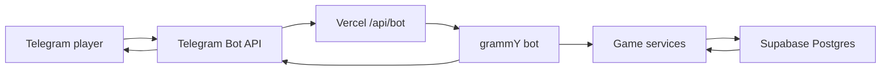

# Delirio RPG

Delirio RPG is a Telegram RPG bot built with Bun, TypeScript, grammY, Supabase, and Vercel Functions.

## Stack

- Bun for local TypeScript scripts and package management
- TypeScript for bot and game logic
- grammY for Telegram Bot API integration
- Supabase Postgres for players, characters, inventory, orders, and game state
- Vercel Functions for webhook-based deployment
- OpenSpec for spec-driven development

## Architecture



Telegram sends updates to `POST /api/bot`. The function validates the Telegram webhook secret, lets grammY process the update, and uses Supabase for persistent state.

See [docs/architecture.md](./docs/architecture.md) for the webhook, dev/prod bot, and Pix payment architecture.

## OpenSpec

This project uses OpenSpec as the source of truth for product and system behavior.

Baseline specs live in:

```txt
openspec/specs/
```

Useful commands after installing the OpenSpec CLI:

```bash
npm install -g @fission-ai/openspec@latest
bun run openspec:list
bun run openspec:validate
bun run openspec:view
```

Before implementing meaningful features, create an OpenSpec change under:

```txt
openspec/changes/<change-name>/
```

The usual flow is:

```txt
proposal.md -> specs -> design.md -> tasks.md -> implementation -> archive
```

## Local Setup

1. Install dependencies:

   ```bash
   bun install
   ```

2. Create a Telegram bot in `@BotFather`.

3. Copy environment variables:

   ```bash
   cp .env.example .env.local
   ```

4. Fill in `BOT_TOKEN`, `TELEGRAM_WEBHOOK_SECRET`, `SUPABASE_URL`, and `SUPABASE_SERVICE_ROLE_KEY`.

5. Run Vercel locally:

   ```bash
   bun run dev
   ```

For local Telegram webhook testing, expose the local server with a tunnel such as ngrok or Cloudflare Tunnel, then set `PUBLIC_WEBHOOK_BASE_URL` to that HTTPS URL.

## Webhook Setup

Production:

```bash
PUBLIC_WEBHOOK_BASE_URL=https://your-vercel-project.vercel.app bun run set-webhook
```

The bot webhook URL will be:

```txt
https://your-vercel-project.vercel.app/api/bot
```

You can also call the protected setup endpoint after deploy:

```txt
POST https://your-vercel-project.vercel.app/api/setup-webhook
Authorization: Bearer <SETUP_WEBHOOK_SECRET>
```

## Dev And Prod Bots

Yes, Telegram supports more than one bot. The clean setup is:

- `Delirio RPG Dev`: separate bot token, separate Vercel preview/local webhook, separate Supabase project or schema
- `Delirio RPG`: production bot token, production Vercel deployment, production Supabase project

Do not point two different deployments at the same bot token. A Telegram bot can have only one active webhook at a time.

## License

This repository is publicly visible but not open source licensed. See [LICENSE](./LICENSE).
