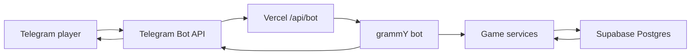

# Delirio RPG

Delirio RPG is a Telegram RPG bot built with Bun, TypeScript, grammY, Supabase, and Vercel Functions.

## Stack

- Bun 1.4.3 for local TypeScript scripts and package management
- TypeScript for bot and game logic
- grammY for Telegram Bot API integration
- Supabase Postgres for players, characters, inventory, orders, and game state
- Vercel Functions for webhook-based deployment
- OpenSpec for spec-driven development

## Architecture



Telegram sends updates to `POST /api/bot`. The function validates the Telegram webhook secret, lets grammY process the update, and uses Supabase for persistent state.

See [docs/architecture.md](./docs/architecture.md) for the webhook, dev/prod bot, and Pix payment architecture.

## OpenSpec

This project uses OpenSpec as the source of truth for product and system behavior.

Baseline specs live in:

```txt
openspec/specs/
```

Useful commands after installing the OpenSpec CLI:

```bash
npm install -g @fission-ai/openspec@latest
bun run openspec:list
bun run openspec:validate
bun run openspec:view
```

Before implementing meaningful features, create an OpenSpec change under:

```txt
openspec/changes/<change-name>/
```

The usual flow is:

```txt
proposal.md -> specs -> design.md -> tasks.md -> implementation -> archive
```

## Testing

Tests use Bun's built-in test runner. Database tests replay every migration in
PGlite (embedded PostgreSQL), including account uniqueness and server-only access.
Bot tests send grammY updates through the real player service and a controlled
Supabase Data API boundary; Telegram API calls are stubbed. No live credentials
or Docker installation are needed. The controlled adapter does not replace
verification against hosted Supabase and Telegram.

```bash
bun test
bun test --watch
bun run typecheck
```

Test files should use the `*.test.ts` convention and import test helpers from `bun:test`.

CI installs from the committed `bun.lock` and runs type checking and the test suite
with the version in `.bun-version`.

## First Access

Use a private conversation with the bot:

- `/start` saves or refreshes your Telegram account and opens the initial menu.
- `/perfil` shows your Telegram name, optional username, and registration date
  (pt-BR, UTC). It also works before `/start`.
- `/ajuda` lists the available commands and works even if the database is down.
- `/povos` opens the read-only guide to the five peoples of Oniri, without requiring
  registration or database access.
- `/essencias` explains the eight Essences, their elements, and their Echoes without
  registration or database access.

The menu contains **Meu perfil**, **Ajuda**, **Povos de Oniri**, and **Essências**. Buttons continue
working across serverless invocations. Repeating a command keeps the same account and registration
date; Telegram profile changes are saved on the next menu or profile access.
Group requests direct the user to the private conversation without saving or
exposing account data. A failed database operation gives a retry instruction and
does not report successful registration.

See [docs/onboarding.md](./docs/onboarding.md) for migration, deployment, smoke-test,
and rollback instructions.

## Peoples of Oniri

Send `/povos` or choose **Povos de Oniri** from the menu to browse Aetheri, Shaqyr,
Uklith, Vahr’Uk, and Humano. Each page includes the people's history, named power,
power description, and Energy bonuses. **Voltar aos povos** returns to the list;
**Menu inicial** returns to the main menu without saving a registration.

The guide is available in private conversations and remains usable during a
database outage. Browsing does not create a character or save a selection.
Unknown guide actions offer a recovery path, and earlier menus continue working
after a new function invocation.

See [docs/peoples-guide.md](./docs/peoples-guide.md) for the content source,
development-bot checks, and rollback instructions.

## Essences

Send `/essencias` or choose **Essências** to browse Êxtase, Melancolia, Serenidade,
Cólera, Confiança, Dissimulação, Altruísmo, and Egoísmo. Each page shows the full
description, Sonho/Pesadelo origin, primary element, three secondary elements,
and the named Echo with its complete effect.

The introduction explains the base point-gain chance, readiness at five points,
the five-point cap, retention between combats, and use without ending the turn
or preventing a Reaction. **Voltar às Essências** returns to the list;
**Menu inicial** returns to the shared menu without saving a registration.
The guide is private, stateless, and available during database outages. It does
not save Essence choices, accumulate points, or execute combat effects.

See [docs/essences-guide.md](./docs/essences-guide.md) for source provenance,
development-bot checks, and rollback instructions.

## Local Setup

Use Bun 1.4.3, pinned in `.bun-version` and `package.json`. To install this version:

```bash
curl -fsSL https://bun.sh/install | bash -s "bun-v1.4.3"
bun --version
```

Vercel uses the `1.4.x` runtime configured in `vercel.json`; Vercel manages the patch version automatically and does not support pinning an exact patch.

1. Install dependencies:

   ```bash
   bun install --frozen-lockfile
   ```

2. Create a Telegram bot in `@BotFather`.

3. Copy environment variables:

   ```bash
   cp .env.example .env.local
   ```

4. Fill in `BOT_TOKEN`, `TELEGRAM_WEBHOOK_SECRET`, `SUPABASE_URL`, and `SUPABASE_SERVICE_ROLE_KEY`.

5. Run Vercel locally:

   ```bash
   bun run dev
   ```

For local Telegram webhook testing, expose the local server with a tunnel such as ngrok or Cloudflare Tunnel, then set `PUBLIC_WEBHOOK_BASE_URL` to that HTTPS URL.

## Webhook Setup

Production:

```bash
PUBLIC_WEBHOOK_BASE_URL=https://your-vercel-project.vercel.app bun run set-webhook
```

The bot webhook URL will be:

```txt
https://your-vercel-project.vercel.app/api/bot
```

You can also call the protected setup endpoint after deploy:

```txt
POST https://your-vercel-project.vercel.app/api/setup-webhook
Authorization: Bearer <SETUP_WEBHOOK_SECRET>
```

## Dev And Prod Bots

Yes, Telegram supports more than one bot. The clean setup is:

- `Delirio RPG Dev`: separate bot token, separate Vercel preview/local webhook, separate Supabase project or schema
- `Delirio RPG`: production bot token, production Vercel deployment, production Supabase project

Do not point two different deployments at the same bot token. A Telegram bot can have only one active webhook at a time.

## License

This repository is publicly visible but not open source licensed. See [LICENSE](./LICENSE).
