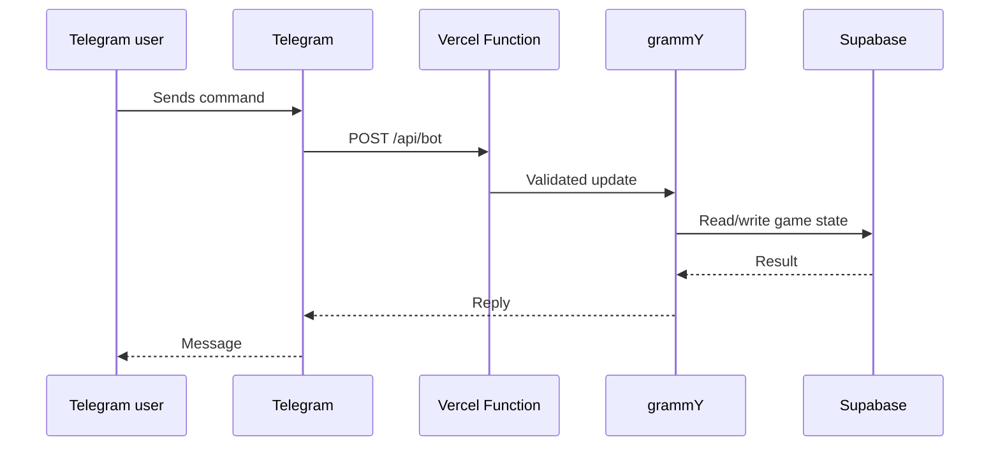
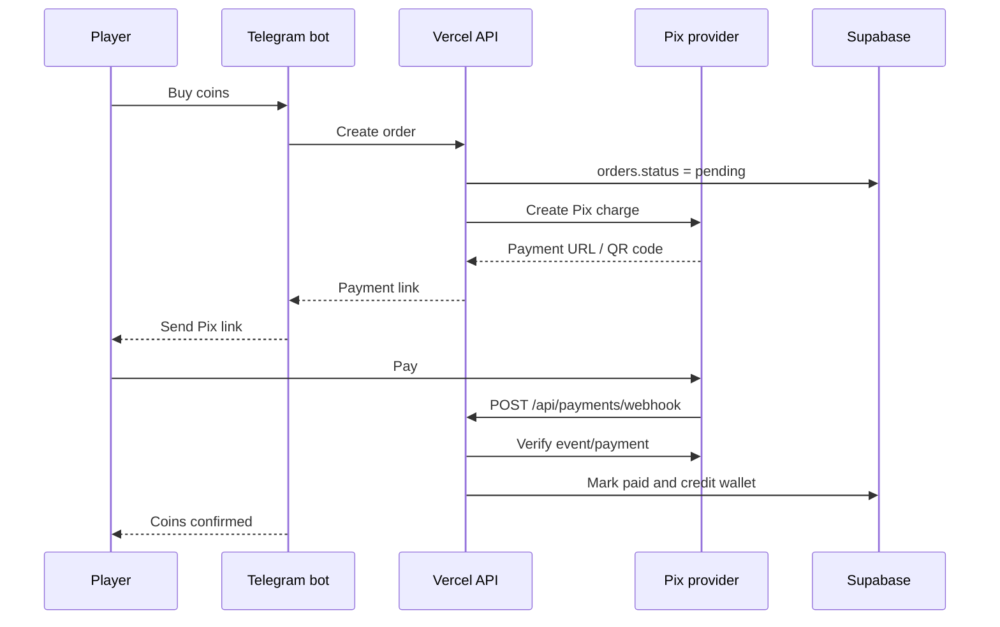

# Delirio RPG Architecture

## Runtime

Delirio RPG runs as webhook-first Telegram bot:

The bot should not use long polling in production. Telegram calls `POST /api/bot`, and Vercel starts a short-lived function invocation for that update.

## Environments

Use two Telegram bots:

- `Delirio RPG Dev` for local tunnels and preview deployments
- `Delirio RPG` for production

A bot token can only have one active webhook at a time, so dev and prod should never share the same token.

## Payments

Pix payments should use an external provider webhook:

Coins must only be granted after a verified provider webhook. Never trust a screenshot, receipt upload, or "I paid" button as proof of payment.

Wallet crediting must be idempotent: if the same webhook is delivered twice, the player receives the coins once.
